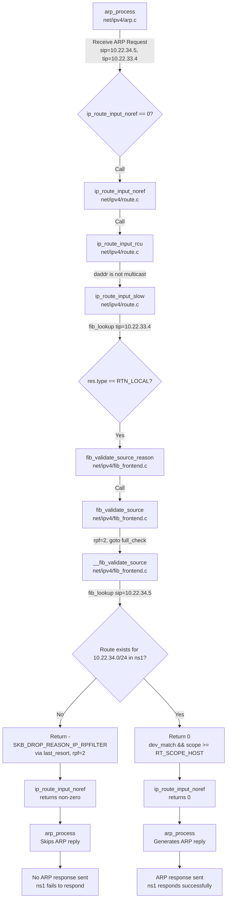

By Rao Shahzaib · DevOps

## Key Takeaway

This article will explain how the routing system works in Linux and, through experiments, demonstrate how to use the routing table (Direct Routing) to enable communication between two different network namespace environments (on different subnets).<br /><br />In addition, during the experiment, we will encounter an interesting issue, and I will walk you through how the Linux kernel (6.16) processes ARP packets.

## Linux Routing System Introduction


In Linux systems, packet forwarding is a core functionality that enables a Linux host to act as a router or gateway, forwarding network packets from one network interface to another. This is critical for building network infrastructure, such as Kubernetes clusters, VPNs, or enterprise routers.


By default, the Linux kernel does `not enable` packet forwarding, requiring manual configuration to activate this feature.

### Kernel Configuration

The Linux kernel manages packet forwarding through specific system parameters, primarily involving a `global switch` and `interface-level` settings.

#### **Global Switch：`net.ipv4.ip_forward`**


The global switch is located at `/proc/sys/net/ipv4/ip_forward` and controls whether the system allows IPv4 packet forwarding.


The default value is `0 (disabled)`, and it must be set to `1 to enable` forwarding.


This is a common configuration step in scenarios like Kubernetes CNI plugin setup.

**Temporary Enable**

```shell
$ sudo sysctl -w net.ipv4.ip_forward=1
# or
$ sudo echo 1 > /proc/sys/net/ipv4/ip_forward
```

**Permanent Enable**

```shell
# Edit /etc/sysctl.conf or a file under /etc/sysctl.d/, adding
net.ipv4.ip_forward = 1

# Then apply the settings
$ sudo sysctl -p
```

#### **Interface-Level Control：`net.ipv4.conf.$NIC.forwarding`**

In addition to the global switch, Linux provides forwarding control for `specific network interfaces` (e.g., eth0, ens33) via `/proc/sys/net/ipv4/conf/$NIC/forwarding`. This setting allows enabling or disabling forwarding for individual interfaces, offering `finer-grained control`.

**Temporary Enable for a Specific Interface**

```shell
$ sudo sysctl -w net.ipv4.conf.eth0.forwarding=1
# or
$ echo 1 > /proc/sys/net/ipv4/conf/eth0/forwarding
```

**Permanent Enable for a Specific Interface**

```shell
# Add to /etc/sysctl.conf or a file under /etc/sysctl.d/
net.ipv4.conf.eth0.forwarding = 1

# Then apply the settings
$ sudo sysctl -p
```

### **Relationship Between Global and Interface-Level Settings**

Packet forwarding is implemented by the Linux kernel and relies on the interplay between the global switch and interface-level settings:

- **Global Switch Priority**: When `net.ipv4.ip_forward` is set to `0`, packet forwarding is `disabled` for `all interfaces`, regardless of interface-level settings. When set to `1`, the `net.ipv4.conf.$NIC.forwarding` setting determines whether forwarding is enabled for a specific interface.
- **Interface-Level Control**: When the global switch is enabled (`net.ipv4.ip_forward=1`), administrators can use `net.ipv4.conf.$NIC.forwarding` to control forwarding behavior for specific interfaces, providing greater flexibility.
- **Routing Table Dependency**: The actual packet forwarding path is determined by the kernel’s routing table. Proper routing rules (e.g., configured using ip route) must be set to ensure packets are correctly forwarded from the source interface to the destination interface.

### Practical Use Cases

#### Kubernetes Networking

In Kubernetes clusters, container networking often relies on the host for packet forwarding. `CNI plugins` (e.g., Flannel, Calico) require the host to enable net.ipv4.ip\_forward to support `inter-Pod communication`. In some custom network environments, enabling net.ipv4.conf.\$NIC.forwarding for specific interfaces may also be necessary to meet specific traffic control requirements.

Reference: [Container Runtimes](https://kubernetes.io/docs/setup/production-environment/container-runtimes/#prerequisite-ipv4-forwarding-optional)

#### Router or Gateway

A Linux host can be configured as a router or gateway to connect different network segments. This requires enabling packet forwarding and configuring appropriate routing tables and firewall rules (e.g., iptables or nftables) to ensure security and proper traffic management.

## Routing Table (RT)

In the Linux kernel, routing tables are a core component of the networking subsystem, responsible for determining how packets are forwarded within or between systems. Linux supports multiple routing tables, enabling flexible routing policy configurations.

### Routing Tables in the Linux Kernel

- **Purpose of Routing Tables**:

  Routing tables store ***`routing rules`*** that determine the transmission path of packets. Each routing table contains a set of routing entries specifying the destination address, next hop, interface, and other related information.

- **Support for Multiple Routing Tables**:

  The Linux kernel supports up to `255` routing tables, identified by `rt_table_id` values ranging from 0 to 255. These tables enable advanced routing strategies, such as policy-based routing based on source address, interface, or custom rules.

- **Management Tools**:

  User-space tools like `ip route` (from the **iproute2** package) are used to manage and query routing tables. Table definitions are typically configured in `/etc/iproute2/rt_tables`.

- **Kernel Implementation**:

  Routing tables are managed by the kernel’s networking subsystem (found in `net/ipv4/route.c` and `net/ipv6/route.c`), and are closely related to the IP forwarding functionality implemented in `devinet.c`.


### **Discussion on `Local`, `Main`, `Default`, and `Unspec` Routing Tables**


From the diagram on the left, we can see that a Linux system has four routing tables by default: **`local`**` (ID: 255)`, **`main`**` (ID: 254)`, **`default`**` (ID: 253)`, and **`unspec`**` (ID: 0)`. These tables define different types of routing rules that determine how packets are transmitted across the network.

- **Priority**: The `local` table has the highest priority, followed by `main`, and then `default` (as part of main). The `unspec` table is rarely involved in actual routing.
- **Configuration File**: Routing table configurations are typically stored in `/etc/iproute2/rt_tables`, where new table names and IDs can be defined.

<table header-row="true">
<tr>
<td>
Routing Table
</td>
<td>
ID
</td>
<td>
Primary Purpose
</td>
<td>
Priority
</td>
<td>
Modifiable by User
</td>
</tr>
<tr>
<td>
**local**
</td>
<td>
255
</td>
<td>
Local interface and loopback packets
</td>
<td>
Highest
</td>
<td>
System-managed
</td>
</tr>
<tr>
<td>
**main**
</td>
<td>
254
</td>
<td>
General packet routing (incl. default)
</td>
<td>
Medium
</td>
<td>
User-configurable
</td>
</tr>
<tr>
<td>
**default**
</td>
<td>
-
</td>
<td>
Default route (within main table)
</td>
<td>
Lowest
</td>
<td>
User-configurable
</td>
</tr>
<tr>
<td>
**unspec**
</td>
<td>
0
</td>
<td>
Unspecified, internal, or temporary use
</td>
<td>
Lowest
</td>
<td>
Rarely used
</td>
</tr>
</table>

##### `local` routing table

- **Definition**: The local routing table is a special table used to store routing information directly related to the local host. It primarily handles packets for local interfaces, such as the loopback interface (e.g., 127.0.0.1) and broadcast addresses.
- **Purpose**:
  - Manages packets for local network interfaces.
  - Includes routes for directly connected network addresses (e.g., 127.0.0.0/8 or IP addresses of local interfaces).
  - These routes are typically auto-generated by the system and have the highest priority.
- **Characteristics**:
  - Cannot be overridden by general routing rules.
  - Typically used for local communication, where packets do not leave the host.
  - Default ID is **`255`**, as defined in `/etc/iproute2/rt_tables`.
- Example:

  This shows routes for the loopback interface and local IP addresses.


  ```bash
  $ ip route show table local

  # output
  local 127.0.0.0/8 dev lo proto kernel scope host src 127.0.0.1
  local 192.168.1.100 dev eth0 proto kernel scope host src 192.168.1.100
  ```

##### `main` routing table

- **Definition**: The main routing table is the default primary routing table in Linux, containing most routing rules for general packet forwarding and transmission.
- **Purpose**:
  - Handles routing for non-local packets, such as those destined for external networks or the internet.
  - Includes the default gateway and other manually or dynamically configured routes.
- **Characteristics**:
  - Default ID is **`254`**.
  - If no specific routing table is specified, the ip route command operates on the main table by default.
  - Most network applications and services rely on this table for packet routing.
- **Example**:

  This indicates the `default gateway` and routes for the `local` network.


  ```bash
  $ ip route show table main

  # output
  default via 192.168.1.1 dev eth0
  192.168.1.0/24 dev eth0 proto kernel scope link src 192.168.1.100
  ```

##### `default` routing table

- **Definition**: The default routing table is not a standalone table but a specific routing rule within the main table, commonly referred to as the **default route**.
- **Purpose**:
  - When a packet’s destination address does not match any specific route, the system forwards the packet to the default gateway.
  - Typically used for connecting to external networks or the internet.
- **Characteristics**:
  - Appears in the main table as default via `<gateway> dev <interface>`.
  - It is the most common route for handling packets with unknown destinations.
- **Example:**

  This indicates that all packets with unknown destinations are sent to 192.168.1.1


  ```bash
  $ ip route show | grep default

  # output
  default via 192.168.1.1 dev eth0
  ```

##### `unspec` routing table

- **Definition**: The unspec routing table is a special table that is rarely used and typically not directly visible in standard Linux routing configurations. It serves as a placeholder or for internal system use, indicating an “unspecified” routing table.
- **Purpose**:
  - Often appears in specific routing protocols or policy routing scenarios, possibly for temporary or undefined routes.
  - The system may use unspec to represent routes not yet assigned to a specific table.
- **Characteristics**:
  - Default ID is **`0`**.
  - Rarely manipulated directly by users and seldom used in practical applications.
  - May be indirectly involved in ip rule or advanced routing configurations.
- **Example**:

  Typically returns no significant content, as the unspec table rarely contains actual routes in standard configurations.


  ```bash
  $ ip route show table 0
  ```

## Experiment 1 - Communicate between network namespaces with different subnet


If you'd like to try this yourself, you can refer to my experimental setup using Vagrant + VirtualBox + Ubuntu 24.04: [Notion page](https://app.notion.com/p/2348a3a7d9d480b7adbec6d6b613f703)


### Experimental Environment Setup

**commands - Create our environment**

```bash
# Create network namespaces and virtual ethernets (VETH)
$ sudo ip netns add ns1
$ sudo ip netns add ns2
$ sudo ip link add veth1 type veth peer name veth2
$ sudo ip link add veth3 type veth peer name veth4

# Rename VETH and attch them to each ns
$ sudo ip link set veth2 netns ns1 name eth0
$ sudo ip link set veth4 netns ns2 name eth0

# Create bridge and then attach veth
$ sudo ip link add br0 type bridge
$ sudo ip link set veth1 master br0
$ sudo ip link set veth3 master br0

# Bring all interfaces up
$ sudo ip link set veth1 up
$ sudo ip link set veth3 up
$ sudo ip link set br0 up
$ sudo ip netns exec ns1 ip link set eth0 up
$ sudo ip netns exec ns2 ip link set eth0 up

# Assign IP address to ns1 & ns2 (Different subnets)
$ sudo ip netns exec ns1 ip addr add 10.22.33.4/24 dev eth0
$ sudo ip netns exec ns2 ip addr add 10.22.34.5/24 dev eth0

# Assign IP address to bro interface (Same subnet as ns1)
$ sudo ip addr add 10.22.33.1 dev br0

```

By using the command above, you will have the environment like below


### Let’s begin the experiment

#### 1. Perform `ping` command from `ns2` to `ns1`


First, let’s try pinging `ns1` from `ns2`.

1. On the `Host` side, listen for packets passing through the `br0` interface.
2. From `ns2`, send a packet to `ns1`:
   1. At this point, you will get `Network is unreachable`.
   2. No packets pass through `br0` on the Host side.
3. Use the command `$ ip r` to check the current routing table in `ns2`.

**This routing rule can be broken down as follows:**

1. **Destination Network:10.22.34.0/24**
   - Indicates the target network is the 10.22.34.0 subnet with a subnet mask of /24 (i.e., 255.255.255.0).
   - This means the route applies to all IP addresses ranging from 10.22.34.0 to 10.22.34.255.
2. **Device (dev): eth0**
   - Packets will be sent through the network interface eth0. This is typically an Ethernet interface, indicating the host’s local network interface.
3. **Protocol (proto): kernel**
   - Indicates this route was automatically added by the kernel, usually generated by the system when configuring the network interface. Such routes typically relate to networks directly connected to the host.
4. **Scope: link**
   - Means the route’s scope is link, which applies only to the local network directly connected to this network interface (communication within the same subnet).
   - This implies packets are not forwarded to other subnets but communicated directly with devices on the same subnet via eth0.
5. **Source Address (src): 10.22.34.5**
   - Indicates that when the host sends packets via this route, it will use 10.22.34.5 as the source IP address. This is usually the IP address assigned to the eth0 interface.


#### 2. Monitor packet at `br0` interface and try `ping` command again


Update `ns2`’s routing table

1. Used the command `$ ip route add 10.22.33.0/24 dev eth0`
   - Command breakdown:
     - **Destination Network: `10.22.33.0/24`**
       - Specifies the target network for this route: 10.22.33.0 with a subnet mask of /24 (255.255.255.0).
       - This means the route applies to all IP addresses in the range 10.22.33.0 to 10.22.33.255.
     - **Device: `dev eth0`**
       - Indicates that packets destined for the 10.22.33.0/24 network should be sent out through the `eth0` network interface.
2. Tried pinging `ns1` again from `ns2`
   1. ***The ping still failed***; communication with `ns1` was not possible.
   2. On the host side, the `br0` interface observed ARP request packets. We saw ARP request was asking who has 10.22.33.4 (it’s the IP address of `ns1`)


#### 3. Monitor packet at `ns1`’s `eth0` interface and try `ping` command again


1. This time, we also monitor the `eth0` interface in `ns1` to see if it receives the ARP packets.
2. Again, from `ns2`, we initiate a ping to `ns1`:
   1. We observe that `ns1`’s `eth0` interface has received the ARP request packets.
   2. However, `ns2` still does not receive a reply.

***Question: if `ns1` received the ARP request, why doesn’t it send a response?***

- This is because `ns1`’s routing table has no entry for how to send packets to `ns2`’s subnet (`10.22.34.0`), so it cannot forward the packet.

#### 4. Update `ns1`’s Routing Table


Update `ns1`’s routing table

Next, in the `ns1` environment, we add `ns2`’s subnet (`10.22.34.0`) to the routing table.

After adding it, we immediately observe that the `br0` interface on the host receives `ICMP Reply` packets from `ns1`, which are then successfully delivered to `ns2`.


## Take a deeper look at how Linux handles ARP packets

In the previous experiment, there was a question as follows:

***Question: if `ns1` received the ARP request, why doesn’t it send a response?***

At that time, our answer was: “This is because `ns1`’s routing table had no entry for how to send packets to `ns2`’s subnet (`10.22.34.0`), so it naturally couldn’t forward the packet.”

But wait — let’s rethink the layers to which ARP and the routing table belong.

***ARP is used to resolve IP addresses to MAC addresses and operates at the Data Link layer (Layer 2). In theory, ARP does not need Layer 3 (IP layer) routing information.***

Since they operate at different layers, why is ARP still influenced by the routing table? Let’s look into the code to uncover the truth!

### Implementation of ARP handling code in the Linux kernel

The following code discussion is based on Linux Kernel version `6.16`

In the Linux kernel, when the system receives an ARP request, it checks whether the source IP of the request is reachable in the routing table (especially when reverse path filtering, `rp_filter`, is enabled). This is because the kernel’s networking stack combines ARP handling with IP layer security checks, particularly to prevent IP spoofing or invalid requests.

This is implemented in the networking subsystem’s `net/ipv4/arp.c` file. When the system receives an ARP request, the kernel performs a series of checks, including a routing table lookup, to decide whether to generate an ARP reply.

##### Introduction to `rp_filter` (Reverse Path Filter)

rp\_filter (Reverse Path Filter) is an important network security feature in Linux systems, ***used to verify whether incoming network packets originate from a legitimate source path***. It primarily helps prevent IP address spoofing attacks by ensuring that the source of a packet aligns with the system's routing table.

**Definition and Purpose**

- **Definition**: rp\_filter is ***a mechanism that performs reverse path checking to validate incoming packets against the system's `routing table` rules***. If a packet's source IP address does not match the expected routing path, the system discards the packet.
- **Purpose**:
  - Prevents spoofed IP packets from entering the system, particularly to mitigate DDoS attacks or network spoofing.
  - Ensures that the source IP of a packet corresponds to the routing path defined in the system’s routing table.
  - Enhances network security, especially in multi-interface or multi-network environments.

**Configuration of rp\_filter**

In Linux, rp\_filter is configured via` /proc/sys/net/ipv4/conf/<interface>/rp_filter` or `/etc/sysctl.conf.` This parameter can be set individually for each network interface or globally (`/proc/sys/net/ipv4/conf/all/rp_filter`).

**Possible Values**:

- **`0`**: Disables reverse path filtering; the system does not check the source path of packets.
- **`1`**: Enables strict mode. The system checks if the source IP belongs to the receiving interface and if that interface is the best path for sending response packets (based on the routing table).
- **`2`**: Enables loose mode. The system only checks if the source IP exists in the routing table (not requiring it to be the best path).

**How It Works**

1. **Strict Mode (rp\_filter=1)**:
   - When a packet arrives at an interface, the system checks the packet’s source IP address.
   - The system simulates the routing of a response packet to verify if it would be sent out via the same interface.
   - If the source IP does not match the best path for the receiving interface, the packet is discarded.
   - Suitable for single-path networks or environments requiring high security.
2. **Loose Mode (rp\_filter=2)**:
   - Only checks if the source IP exists in the system’s routing table, without requiring the response packet to use the same interface.
   - Suitable for asymmetric routing environments, such as multi-path or load-balanced scenarios.
3. **Disabled (rp\_filter=0)**:
   - No reverse path checks are performed, allowing all packets to pass.
   - May be used in specific network configurations but offers lower security.

#### Experiment Environment Review

**Network Configuration**:

- **ns1**:
  - Interface: eth0, IP: 10.22.33.4/24 (subnet 10.22.33.0/24).
  - Initial routing table:
    ```bash
    10.22.33.0/24 dev eth0 proto kernel scope link src 10.22.33.4
    ```

    - Missing route to 10.22.34.0/24.
  - `rp_filter=2` (loose mode).
- **ns2**:
  - Interface: eth0, IP: 10.22.34.5/24 (subnet 10.22.34.0/24).
- **br0**:
  - IP: 10.22.33.1/24 (subnet 10.22.33.0/24).
  - Bridges ns1 and ns2 to provide Layer 2 communication.

**Behavior**:

- `ns2` (10.22.34.5) pings `ns1` (10.22.33.4), sending an ARP request to resolve 10.22.33.4’s MAC address.
- `ns1` receives the ARP request (sip = 10.22.34.5, tip = 10.22.33.4) but does not respond because its routing table lacks an entry for 10.22.34.0/24.
- After adding the route on `ns1` using `ip route add 10.22.34.0/24 dev eth0`, `ns1` replies to the ARP request, and the ping succeeds.

#### Kernel Code analysis

```txt
arp_process (arp.c)
  └── ip_route_input_noref (route.c)
      └── ip_route_input_rcu (route.c)
          └── ip_route_input_slow (route.c)
              └── fib_validate_source (fib_frontend.c)
                  └── __fib_validate_source (fib_frontend.c)
                      └── fib_lookup (src = sip = 10.22.34.5)
                          ├── Success: return 0 → ARP reply
                          └── Fail: return -SKB_DROP_REASON_IP_RPFILTER → No ARP reply
```

**Mermaid flowchart in `ns1`**



**\[[net/ipv4/arp.c](https://github.com/torvalds/linux/blob/v6.16/net/ipv4/arp.c#L701)\] function `arp_process` → function `ip_route_input_noref`**

```c
// https://github.com/torvalds/linux/blob/v6.16/net/ipv4/arp.c#L701
int arp_process(struct sk_buff *skb)
{
    struct net_device *dev = skb->dev;
    struct in_device *in_dev = __in_dev_get_rcu(dev);
    struct arphdr *arp;
    unsigned char *arp_ptr;
    struct rtable *rt;
    unsigned char *sha, *tha;
    __be32 sip, tip;
    u16 dev_type = dev->type;
    int addr_type;
    ...

    /* Parse ARP Header */
    // https://github.com/torvalds/linux/blob/v6.16/net/ipv4/arp.c#L724
    arp = arp_hdr(skb);
    ...

    /*
    *	Extract fields
    */
    // https://github.com/torvalds/linux/blob/v6.16/net/ipv4/arp.c#L767-L774
  	arp_ptr = (unsigned char *)(arp + 1);
	  sha	= arp_ptr; /* Sender MAC address */
  	arp_ptr += dev->addr_len;
	  memcpy(&sip, arp_ptr, 4); /* Sender IP address */
  	arp_ptr += 4;
    ...

    // https://github.com/torvalds/linux/blob/v6.16/net/ipv4/arp.c#L780-L784
   	default:
	  	tha = arp_ptr;  /* Destination MAC address */
		  arp_ptr += dev->addr_len;
	  }
	  memcpy(&tip, arp_ptr, 4);  /* Destination IP address */
    ...

    // https://github.com/torvalds/linux/blob/v6.16/net/ipv4/arp.c#L839-L840
    if (arp->ar_op == htons(ARPOP_REQUEST) &&
	    ip_route_input_noref(skb, tip, sip, 0, dev) == 0) { /* skb：ARP packer，tip = 10.22.33.4，sip = 10.22.34.5，dev = eth0 */
	    ...
	  }

}
```

**\[[net/ipv4/route.c](https://github.com/torvalds/linux/blob/v6.16/net/ipv4/route.c#L2537)\] function `ip_route_input_noref` → function `ip_route_input_rcu`**

```c
// https://github.com/torvalds/linux/blob/v6.16/net/ipv4/route.c#L2537-L2550
enum skb_drop_reason ip_route_input_noref(struct sk_buff *skb, __be32 daddr,
					  __be32 saddr, dscp_t dscp,
					  struct net_device *dev)
{
	enum skb_drop_reason reason;
	struct fib_result res;

	rcu_read_lock();
	reason = ip_route_input_rcu(skb, daddr, saddr, dscp, dev, &res); /* daddr = tip = 10.22.33.4，saddr = sip = 10.22.34.5，dscp = 0 */
	rcu_read_unlock();

	return reason;
}
EXPORT_SYMBOL(ip_route_input_noref);
```

**\[[net/ipv4/route.c](https://github.com/torvalds/linux/blob/v6.16/net/ipv4/route.c#L2483)\] function `ip_route_input_rcu` → function `ip_route_input_slow`**

```c
// https://github.com/torvalds/linux/blob/v6.16/net/ipv4/route.c#L2483-L2535
/* called with rcu_read_lock held */
static enum skb_drop_reason
ip_route_input_rcu(struct sk_buff *skb, __be32 daddr, __be32 saddr,
		   dscp_t dscp, struct net_device *dev,
		   struct fib_result *res)
{
	...
	if (ipv4_is_multicast(daddr)) { /* Check whether daddr (10.22.33.4) is a multicast address (224.0.0.0/4) */
		...
	}
  // https://github.com/torvalds/linux/blob/v6.16/net/ipv4/route.c#L2534
	return ip_route_input_slow(skb, daddr, saddr, dscp, dev, res); /* Since 10.22.33.4 is a unicast address, the multicast logic is skipped, and ip_route_input_slow is called directly. */
}
```

**\[[net/ipv4/route.c](https://github.com/torvalds/linux/blob/v6.16/net/ipv4/route.c#L2347)\] function `ip_route_input_slow` → function `fib_validate_source_reason` **

```c
// https://github.com/torvalds/linux/blob/v6.16/net/ipv4/route.c#L2347-L2352
static enum skb_drop_reason
ip_route_input_slow(struct sk_buff *skb, __be32 daddr, __be32 saddr,
                    dscp_t dscp, struct net_device *dev,
                    struct fib_result *res)
{
    enum skb_drop_reason reason = SKB_DROP_REASON_NOT_SPECIFIED;
    struct in_device *in_dev = __in_dev_get_rcu(dev);  /* Obtain the IPv4 configuration of eth0 */
    ...
    if (!in_dev)   /* eth0 is configured with 10.22.33.4, in_dev exists */
        goto out;
    ...

    if (ipv4_is_multicast(saddr) || ipv4_is_lbcast(saddr)) { /* ipv4_is_multicast(saddr): saddr (10.22.34.5) is not multicast (224.0.0.0/4). ipv4_is_lbcast(saddr): not a link-local broadcast (255.255.255.255). */
        reason = SKB_DROP_REASON_IP_INVALID_SOURCE;
        goto martian_source;
    }
    ...
    if (ipv4_is_zeronet(saddr)) {      /* saddr (10.22.34.5) is not in the zero network (0.0.0.0/8) */
        reason = SKB_DROP_REASON_IP_INVALID_SOURCE;
        goto martian_source;
    }
    if (ipv4_is_zeronet(daddr)) {.     /* daddr（10.22.33.4）is not in the zero network (0.0.0.0/8) */
        reason = SKB_DROP_REASON_IP_INVALID_DEST;
        goto martian_destination;
    }
    if (ipv4_is_loopback(daddr)) {.  /* daddr (10.22.33.4) is not in not127.0.0.0/8 */
        if (!IN_DEV_NET_ROUTE_LOCALNET(in_dev, net)) {
            reason = SKB_DROP_REASON_IP_LOCALNET;
            goto martian_destination;
        }
    } else if (ipv4_is_loopback(saddr)) {
        if (!IN_DEV_NET_ROUTE_LOCALNET(in_dev, net)) {
            reason = SKB_DROP_REASON_IP_LOCALNET;
            goto martian_source;
        }
    }
    ...
    fl4.flowi4_iif = dev->ifindex;    /* eth0 index */
    fl4.daddr = daddr;   /* 10.22.33.4 */
    fl4.saddr = saddr;   /* 10.22.34.5 */
    fl4.flowi4_tos = inet_dscp_to_dsfield(dscp);
    ...
    // https://github.com/torvalds/linux/blob/v6.16/net/ipv4/route.c#L2347-L2352
		/* Check fl4.daddr (10.22.33.4). Since 10.22.33.4 is ns1’s local IP, and the routing table contains
				10.22.33.0/24 dev eth0 proto kernel scope link src 10.22.33.4,
				fib_lookup succeeds with res.type = RTN_LOCAL. */
    err = fib_lookup(net, &fl4, res, 0);
    if (err != 0) {
        if (!IN_DEV_FORWARD(in_dev))
            err = -EHOSTUNREACH;
        goto no_route;
    }
    ...
    // https://github.com/torvalds/linux/blob/v6.16/net/ipv4/route.c#L2363-L2370
    if (res.type == RTN_LOCAL) {
        reason = fib_validate_source_reason(skb, saddr, daddr, dscp, 0, dev, in_dev, &itag); /* call fib_validate_source_reason to check saddr (10.22.34.5) */
        if (reason)
            goto martian_source;
        goto local_input;
    }
    ...
}
```

**\[[net/ip\_fib.h](https://github.com/torvalds/linux/blob/v6.16/include/net/ip_fib.h#L457C1-L467C2)\] function `fib_validate_source_reason` → function `fib_validate_source`**

```c
// https://github.com/torvalds/linux/blob/v6.16/include/net/ip_fib.h#L457C1-L467C2
static inline enum skb_drop_reason
fib_validate_source_reason(struct sk_buff *skb, __be32 src, __be32 dst,
			   dscp_t dscp, int oif, struct net_device *dev,
			   struct in_device *idev, u32 *itag)
{
  /* src = sip = 10.22.34.5, dst = tip = 10.22.33.4, oif = 0, dev = eth0 */
	int err = fib_validate_source(skb, src, dst, dscp, oif, dev, idev,
				      itag);
	if (err < 0)
		return -err;
	return SKB_NOT_DROPPED_YET;
}
```

**\[[net/ipv4/fib\_frontend.c](https://github.com/torvalds/linux/blob/v6.16/net/ipv4/fib_frontend.c#L427-L460)\] function `fib_validate_source` → function `__fib_validate_source`**

```c
// https://github.com/torvalds/linux/blob/v6.16/net/ipv4/fib_frontend.c#L427-L460
int fib_validate_source(struct sk_buff *skb, __be32 src, __be32 dst,
			dscp_t dscp, int oif, struct net_device *dev,
			struct in_device *idev, u32 *itag)
{
  /* Check rp_filter, r = IN_DEV_RPFILTER(idev): rp_filter=2, so r = 2.
	secpath_exists(skb): The ARP request has no IPsec, so r remains unchanged. */
	int r = secpath_exists(skb) ? 0 : IN_DEV_RPFILTER(idev);
	struct net *net = dev_net(dev);

	if (!r && !fib_num_tclassid_users(net) &&
	    (dev->ifindex != oif || !IN_DEV_TX_REDIRECTS(idev))) {
		if (IN_DEV_ACCEPT_LOCAL(idev))
			goto ok;
		...
		if (net->ipv4.fib_has_custom_local_routes ||
		    fib4_has_custom_rules(net))
			goto full_check;
		...
		if (inet_lookup_ifaddr_rcu(net, src))
			return -SKB_DROP_REASON_IP_LOCAL_SOURCE;

ok:
		*itag = 0;
		return 0;
	}

full_check:
	return __fib_validate_source(skb, src, dst, dscp, oif, dev, r, idev,
				     itag);
}
```

**\[[net/ipv4/fib\_frontend.c](https://github.com/torvalds/linux/blob/v6.16/net/ipv4/fib_frontend.c#L336-L425)\] function `__fib_validate_source` → function `fib_lookup` → block last\_resort → block e\_rpf → return -SKB\_DROP\_REASON\_IP\_RPFILTER**

```c
// https://github.com/torvalds/linux/blob/v6.16/net/ipv4/fib_frontend.c#L336-L425
static int __fib_validate_source(struct sk_buff *skb, __be32 src, __be32 dst,
				 dscp_t dscp, int oif, struct net_device *dev,
				 int rpf, struct in_device *idev, u32 *itag)
{
	...

	fl4.flowi4_oif = 0;
	fl4.flowi4_l3mdev = l3mdev_master_ifindex_rcu(dev);
	fl4.flowi4_iif = oif ? : LOOPBACK_IFINDEX; /* The input interface is oif (which is 0 in ARP, using the loopback interface index), so here it is LOOPBACK_IFINDEX. */
	fl4.daddr = src;  /* src（sip，10.22.34.5） */
	fl4.saddr = dst;  /* dst（tip，10.22.33.4）） */
	fl4.flowi4_tos = inet_dscp_to_dsfield(dscp);
	fl4.flowi4_scope = RT_SCOPE_UNIVERSE;
	fl4.flowi4_tun_key.tun_id = 0;
	fl4.flowi4_flags = 0;
	fl4.flowi4_uid = sock_net_uid(net, NULL);
	fl4.flowi4_multipath_hash = 0;

	no_addr = idev->ifa_list == NULL;

	...
	// https://github.com/torvalds/linux/blob/v6.16/net/ipv4/fib_frontend.c#L379-L380
	if (fib_lookup(net, &fl4, &res, 0)) /* Check fl4.daddr (10.22.34.5). ns1’s routing table only contains 10.22.33.0/24 and lacks 10.22.34.0/24. The fib_lookup fails and jumps to last_resort. */
		goto last_resort;
	if (res.type != RTN_UNICAST) {
		if (res.type != RTN_LOCAL) {
			reason = SKB_DROP_REASON_IP_INVALID_SOURCE;
			goto e_inval;
		} else if (!IN_DEV_ACCEPT_LOCAL(idev)) {
			reason = SKB_DROP_REASON_IP_LOCAL_SOURCE;
			goto e_inval;
		}
	}

	...

// https://github.com/torvalds/linux/blob/v6.16/net/ipv4/fib_frontend.c#L415
last_resort:
	if (rpf) /* rpf is 2 (loose mode)*/
		goto e_rpf;
	*itag = 0;
	return 0;

...
// https://github.com/torvalds/linux/blob/v6.16/net/ipv4/fib_frontend.c#L423
e_rpf:
	return -SKB_DROP_REASON_IP_RPFILTER;
}
```

#### Code Summary

In Linux 6.16, the `__fib_validate_source` function performs the following steps:

1. **Flow Setup**: Sets `src` (sip, 10.22.33.x) as the lookup target.
2. **Routing Lookup**: `fib_lookup` checks whether `src` is reachable via the routing table.
3. **Type Check**: Ensures that the route is of type `RTN_UNICAST` or the allowed `RTN_LOCAL`.
4. **Device Match**: Verifies whether the route uses the receiving interface (eth0).
5. **Fallback Handling**: If `fib_lookup` fails and `rp_filter` is non-zero (in my case, it's 2), it returns `SKB_DROP_REASON_IP_RPFILTER`.

In this case, since `ns1` lacks the `10.22.34.0/24` route, `fib_lookup` fails, and `__fib_validate_source` returns `-SKB_DROP_REASON_IP_RPFILTER`, preventing the ARP reply.

After the route is added, `fib_lookup` succeeds and returns `0`, allowing `ns1`’s ARP to send out the ARP Reply packet.

## Conclusion

In this article, we have drawn the following conclusions:

- Gained a basic understanding of the Linux routing system.
- Successfully pinged between different subnets.
- Learned that when processing ARP packets, the Linux kernel still consults the routing table.
